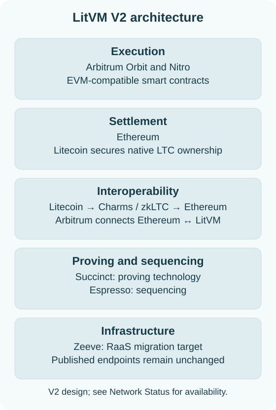

# Architecture

LitVM is an **EVM-compatible Arbitrum Orbit chain using Ethereum settlement**. It connects Litecoin assets with programmable applications through an interoperability layer built with Charms Protocol.

## Architecture overview

<figure><figcaption>Component roles in the V2 design. See Network Status for availability and infrastructure migration notes.</figcaption></figure>

## Execution and settlement

**Arbitrum Orbit** provides the chain framework, and **Arbitrum Nitro** provides the EVM-compatible execution environment. Developers use familiar smart contract languages and Ethereum tooling, with the differences described in [EVM Differences](../deploy-on-testnet/evm-differences.md).

**Ethereum is LitVM’s settlement layer.** Native LTC remains an asset of the Litecoin blockchain; its ownership and security should not be confused with settlement of the LitVM chain.

## Proving and sequencing

**Succinct** provides the zkVM technology for the proving component of LitVM’s architecture. Proof-based validation of Charms assets and proving of LitVM execution serve different purposes and should be considered separately.

**Espresso** provides the sequencing component, supporting transaction ordering and cross-chain coordination. See [Network Status](../resources/network-status.md) for network-specific availability notes.

## Litecoin interoperability

The intended V2 asset flow is:

**Litecoin → Charms / zkLTC → Ethereum → Arbitrum → LitVM**

| Layer | Role |
| --- | --- |
| Litecoin | Native LTC ownership and base-chain security |
| Charms Protocol | Proof-based interoperability for representing LTC on EVM as zkLTC |
| Ethereum | zkLTC as an ERC-20-compatible asset and settlement for LitVM |
| Arbitrum infrastructure | Movement of zkLTC between Ethereum and LitVM |
| LitVM | EVM applications, with zkLTC intended as the native gas asset |

The route has two underlying infrastructure layers:

* **Litecoin ↔ Ethereum:** Charms.
* **Ethereum ↔ LitVM:** Arbitrum.

The **LitVM Bridge** is intended to abstract these steps into one user-facing process. Technical documentation distinguishes the two layers even where the product presents a unified experience.

## zkLTC

zkLTC is designed to represent native LTC in the EVM ecosystem. In the V2 architecture, it exists as an ERC-20-compatible asset on Ethereum and moves into LitVM through Arbitrum infrastructure. Within LitVM, zkLTC is intended to serve as the native gas asset and an asset used by applications.

See [$LITVM & $zkLTC](usdlitvm-and-usdzkltc.md) for the distinction between the gas asset and the governance token.

## Infrastructure

**Zeeve** is replacing Caldera as LitVM’s Rollup-as-a-Service infrastructure provider. The migration is in progress. Existing published Caldera-hosted connection details remain in [Network Configuration](../get-started/network-configuration.md) until replacement endpoints are confirmed.

## Security model

Each layer has a distinct responsibility:

* Litecoin secures native LTC transactions and ownership on its chain.
* Charms uses client-side validation and cryptographic proofs for programmable asset state and transitions.
* Arbitrum infrastructure provides the Ethereum ↔ LitVM connection.
* Ethereum provides settlement for the LitVM chain.
* Proving, sequencing, and infrastructure services support chain operation according to their integrations.

Security of the complete route depends on the deployed integrations and their operating conditions. A component’s cryptographic properties or audit history do not establish an audit or guarantee for the entire LitVM system.

## Network reference

* [Network Configuration](../get-started/network-configuration.md) — published RPC, WebSocket, explorer, and faucet details.
* [Network Status](../resources/network-status.md) — availability and migration notes.
* [Add to Your Wallet](../get-started/add-to-wallet.md) — wallet setup.
