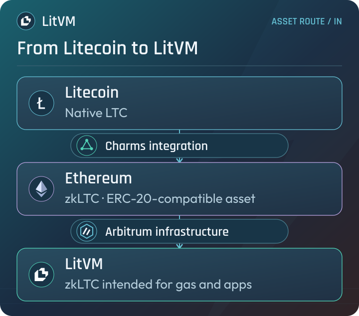
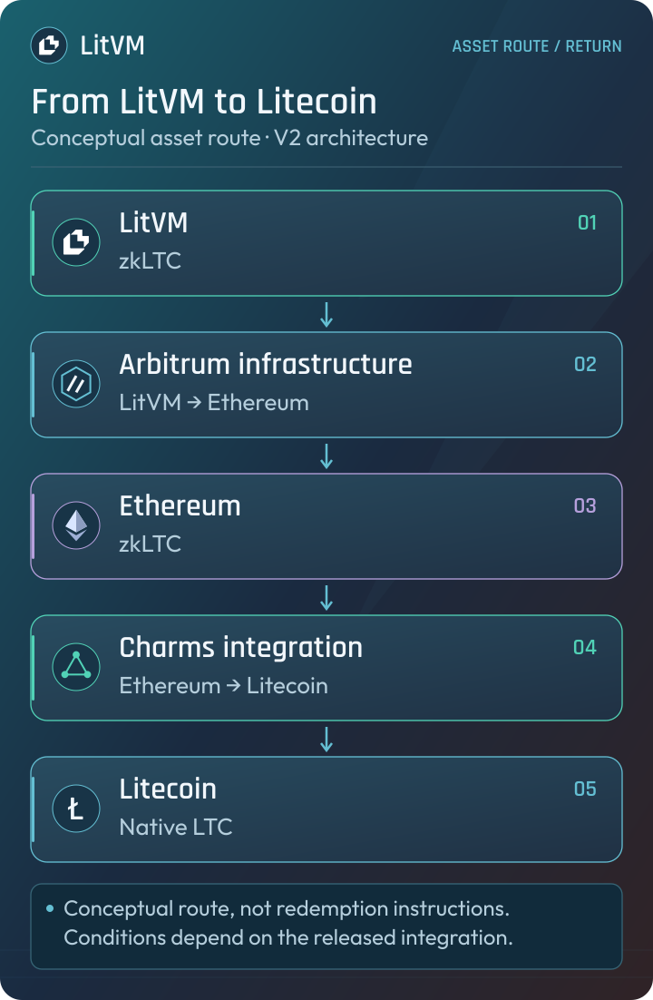

# Charms Protocol

Charms is an open-source protocol for programmable assets across UTXO-based blockchains. It is the Litecoin interoperability layer in LitVM’s V2 architecture.

## Programmable assets and client-side validation

Charms uses **client-side validation** and **zero-knowledge proofs** to establish the validity of asset state and state transitions. Charms-aware software checks the relevant proofs; the underlying UTXO blockchain does not need to execute the full application logic as an EVM chain would.

The base blockchain provides ownership and settlement security for its UTXOs. Charms supplies the programmable asset layer, supporting fungible tokens, NFTs, and application state.

## Cross-chain movement

Charms calls its proof-based mechanism for moving assets between supported chains **beaming**. Proofs establish continuity between the source and destination state, rather than relying on a conventional custodial bridge operator to determine asset validity.

This describes the general Charms protocol. The exact issuance, redemption, and operational conditions of a particular asset depend on its integration.

## Charms and LitVM

LitVM is helping fund and co-develop Litecoin and Ethereum support with the creator of Charms. This work provides the foundation for native LTC to be represented on Ethereum as **zkLTC**, an ERC-20-compatible asset.

The intended route into LitVM is:

**Litecoin → Charms / zkLTC → Ethereum → Arbitrum → LitVM**

* **Charms** provides the Litecoin ↔ Ethereum interoperability layer.
* **Arbitrum infrastructure** connects Ethereum and LitVM.
* The **LitVM Bridge** is intended to present these steps as one user-facing process.

<figure><figcaption>V2 asset flow. Integration availability is documented separately in Network Status.</figcaption></figure>

The return route follows the same infrastructure layers in reverse:

<figure><figcaption>Conceptual return route; this diagram does not specify redemption timing or mechanics.</figcaption></figure>

## Security boundaries

Charms asset validation, native LTC ownership, and LitVM settlement are separate parts of the architecture. Cryptographic validation of an asset transition is distinct from the operation of a complete cross-chain product.

For the LitVM integration, issuance and redemption conditions, supported routes, and operational availability should be checked against the released product documentation.

## Resources

* [Charms documentation](https://docs.charms.dev/)
* [Charms concepts](https://docs.charms.dev/concepts/)
* [Beaming](https://docs.charms.dev/concepts/beaming/)
* [LitVM architecture](architecture.md)
* [zkLTC](usdlitvm-and-usdzkltc.md)
* [Network status](../resources/network-status.md)
