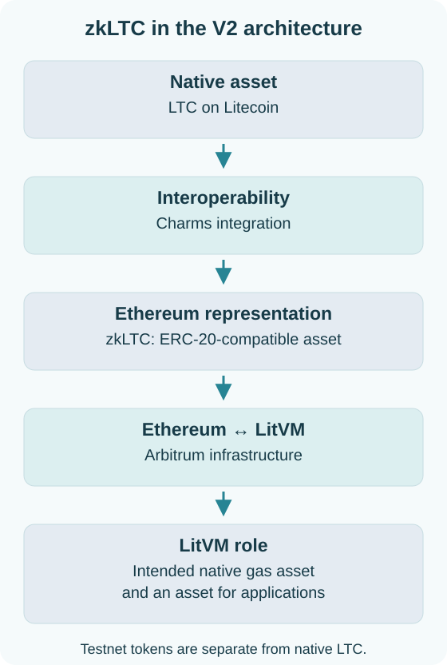
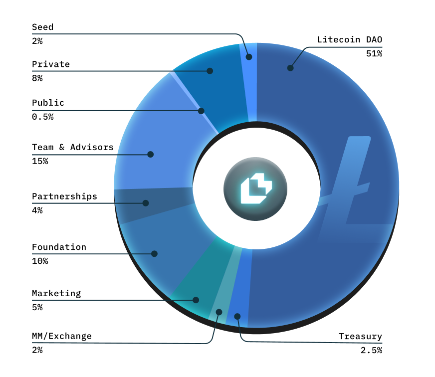
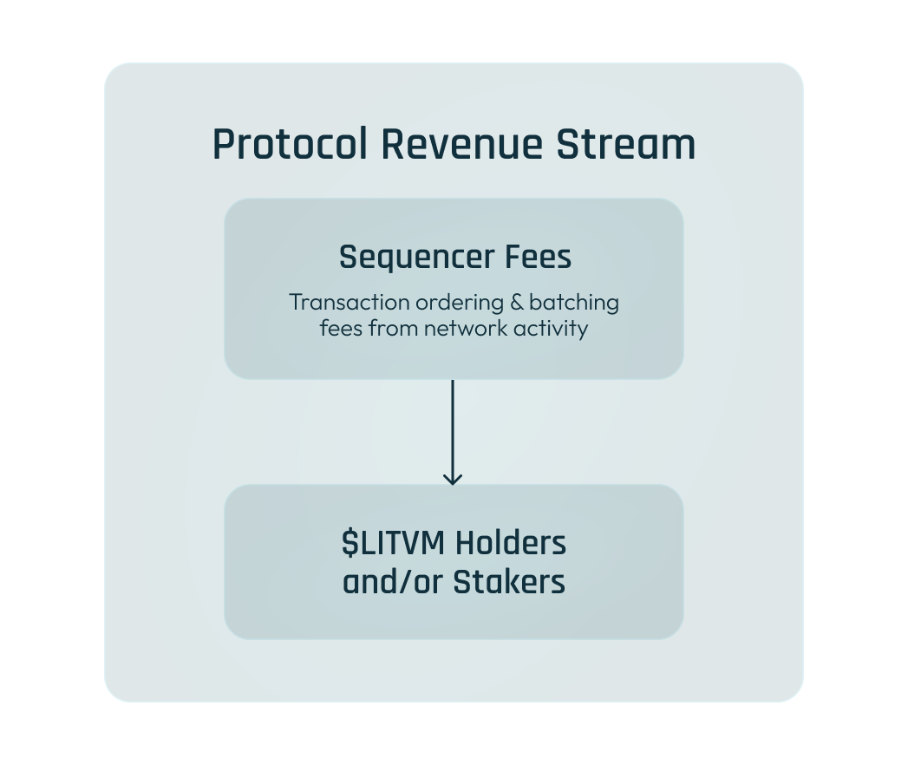

# $LITVM & $zkLTC

LitVM operates with a dual-token model designed to align incentives across the ecosystem while maintaining the principles of hard money. Each token serves a distinct purpose in powering the network.

## zkLTC — The Gas Asset

### What is zkLTC?

zkLTC is designed to represent native Litecoin (LTC) in the EVM ecosystem. Under LitVM’s V2 architecture, it exists as an ERC-20-compatible asset on Ethereum and moves between Ethereum and LitVM through Arbitrum infrastructure. Within LitVM, zkLTC is intended to serve as the native gas asset and a base asset for applications.

### How zkLTC fits into the architecture

<figure><figcaption>zkLTC’s role in the V2 architecture.</figcaption></figure>

| Component | Role |
| --- | --- |
| Native LTC | The underlying asset on Litecoin |
| Charms integration | Proof-based interoperability for representing LTC on EVM |
| zkLTC on Ethereum | ERC-20-compatible asset |
| Arbitrum infrastructure | Ethereum ↔ LitVM movement |
| zkLTC on LitVM | Intended native gas asset and an asset used by applications |

### zkLTC and conventional wrapped LTC

A conventional custodial wrapped asset depends on an issuer or custodian to manage its representation. LitVM’s Charms integration is designed around cryptographic validation of asset state and transitions.

Client-side asset validation, native LTC ownership, Ethereum settlement, and the Arbitrum connection are distinct parts of the complete route. Issuance, backing, redemption conditions, and operational availability must be established by the released integration documentation; they should not be inferred from the general protocol description.

See [Charms Protocol](charms.md) for the validation model and [Network Status](../resources/network-status.md) for availability notes.

### Intended uses within LitVM

* **Transaction fees:** Gas for smart contract interactions.
* **DeFi applications:** An asset for trading, lending, and collateral where supported.
* **Liquidity:** A base asset for application liquidity pairs.
* **Interoperability:** Movement between Ethereum and LitVM through Arbitrum infrastructure.

***

## $LITVM — The Governance & Utility Token

### What is $LITVM?

**$LITVM** is the native governance and utility token of the LitVM ecosystem. It coordinates activity between the economic, governance, and strategic layers of the network, making them function as a cohesive unit.

### Token Utility

#### Governance

$LITVM powers the **Litecoin DAO**, giving token holders rights to:

* Vote on protocol parameters and upgrades
* Propose and approve ecosystem grants
* Participate in strategic funding decisions
* Shape the future direction of LitVM

**Governance Incentives:** Active participants who vote, propose, and engage in community dialogue are eligible for rewards, encouraging ongoing engagement.

#### Revenue Sharing

LitVM is one of the few Layer-2 platforms explicitly designed to share protocol revenue with its community:

**Sequencer Fee Distribution**

* Sequencers order and batch transactions on LitVM
* A percentage of sequencer fees flows to $LITVM holders and/or stakers
* Unlike chains where fees go entirely to operators, LitVM distributes value back

This model transforms core infrastructure usage into tangible, recurring revenue that flows directly to community members. It's a model that aligns protocol growth with stakeholder benefit, extending $LITVM beyond an ordinary governance token into a claim on the economic activity of its network.

#### Ecosystem Access

* Priority access to new protocol launches
* Participation in Litecoin DAO initiatives
* Eligibility for ecosystem incentive programs

### Tokenomics

LitVM's tokenomics prioritize the community over insiders:

<figure><figcaption></figcaption></figure>

**51% Community Allocation** — Over half of all tokens are reserved for the community, prioritizing current Litecoin holders and welcoming new ecosystem participants.

### Revenue Model

LitVM's revenue model creates sustainable value through protocol fees:

<figure><figcaption></figcaption></figure>

Rather than relying on inflationary rewards or inorganic social hype, LitVM transforms core infrastructure usage into tangible, recurring revenue that flows directly to community members.

### Institutional Yield Infrastructure

LitVM is bringing yield infrastructure designed for institutional capital:

* **DNA Fund Strategy Vaults**: Actively managed products for high-net-worth individuals and funds (in addition to retail users)
* **Management & Performance Fees**: Portion redirected to $LITVM holders and/or stakers
* **Retail Access**: Institutional strategies available to everyday users

***

## Why Two Tokens?

The dual-token model serves distinct purposes:

| **Aspect**           | **zkLTC**                      | **$LITVM**             |
| -------------------- | ------------------------------ | ---------------------- |
| **Primary Function** | Gas & Base Asset               | Governance & Utility   |
| **Backing**          | LTC representation via the Charms integration | Protocol value |
| **Supply**           | Issuance follows integration rules | Fixed                  |
| **Use Case**         | Transactions & DeFi            | Voting & Revenue       |
| **Economic Role**    | Hard money base layer          | Ecosystem coordination |

### Benefits of Separation

* **Hard Money Preservation**: zkLTC connects the intended gas model with Litecoin as the underlying asset
* **Clear Incentives**: Governance token aligns long-term stakeholders
* **Sustainable Economics**: Revenue sharing creates value beyond speculation
* **Flexible Tokenomics**: Each token can be optimized for its specific role

***

## Token Launch

### Availability

Refer to [Network Status](../resources/network-status.md) and official announcements for network and launch updates. Testnet zkLTC is used for network testing and is separate from native LTC interoperability through the V2 route.

### How to Participate

* **Early Access**: Follow [@LitecoinVM](https://twitter.com/LitecoinVM) for testnet access updates
* **Community Campaigns**: Participate in initiatives and earn rewards
* **Litecoin Holders**: Existing LTC holders will be prioritized

***

## Summary

| **Token**  | **Purpose**           | **Key Feature**                                      |
| ---------- | --------------------- | ---------------------------------------------------- |
| **zkLTC**  | Intended gas and application asset | LTC representation through Charms and Arbitrum infrastructure |
| **$LITVM** | Governance & utility  | Majority community-owned/controlled, revenue sharing |

Together, these tokens create a sustainable ecosystem that honors Litecoin's hard money principles while enabling programmable functionality and community governance.
